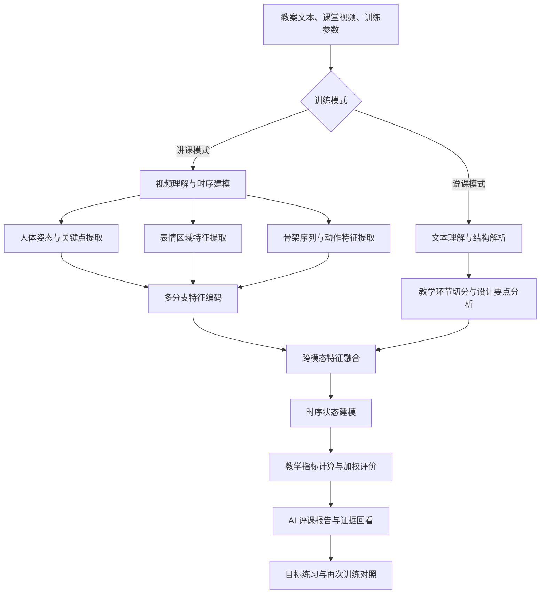

# 临客 LINK 产品宣传报告

_50 万元创业基金申请版｜面向师范生与职前教师的 AI 微格教学训练平台｜2026-11-06_

---

> **一句话介绍：** 临客 LINK 正在构建面向教师教育的 AI 微格教学训练与评价平台，以文本理解和课堂多模态感知为基础，把“备课分析—模拟授课—过程评价—证据回看—针对性复练”连成可持续迭代的训练闭环。
>
> **当前边界：** 产品聚焦教学练习与反思，不替代真实课堂、指导教师判断或正式教师资格评价。现阶段实时模拟授课主要支持小学数学《分数的初步认识》。

## 🧭 产品概览

临客 LINK 是一款面向教师教育场景的浏览器端 AI 微格教学训练平台。项目以已经搭建的模拟课堂、虚拟学生互动、课堂记录、AI 辅助评课和教学知识库为产品基础，进一步规划将教案文本分析与授课过程视频分析融合，形成覆盖课前设计、课中表现和课后改进的智能训练闭环。

产品目标不止于“给试讲打一个分”，而是建立可解释、可回看、可复练的教学能力训练链路：让练习者知道课堂中发生了什么、系统依据什么作出判断，以及下一次可以具体练什么。多模态融合与时序评估是项目的技术演进路线，需通过后续研发和真人试点逐步完成验证。

| 项目 | 当前情况 |
| --- | --- |
| 产品形态 | 浏览器 Web 应用 |
| 核心用户 | 师范生、职前教师；教师教育课程教师可作为指导者 |
| 当前实时课堂课题 | 小学数学三年级《分数的初步认识》 |
| 课程与资源 | 包含教学技能课程资料、资源阅读与个人成长记录；资料覆盖不等同于所有课题均支持实时模拟 |
| 产品定位 | 教学练习与反思辅助，不是认证或正式考核工具 |

## 🎯 市场痛点与产品价值

师范生和职前教师需要反复试讲，才能练习讲解、提问、候答、追问、反馈与课堂组织。仅靠有限的线下试讲机会，练习者较难在低成本环境中重复尝试；课后反馈也可能难以对应到具体课堂行为，导致“知道要改进”却不清楚下一步怎么练。

临客 LINK 围绕一次练习的前、中、后环节设计体验：在模拟课堂中练习互动，在课后回到时间点和事件核对反馈，再把问题转化为下一轮练习目标。

| 用户痛点 | 产品回应 | 用户可获得的帮助 |
| --- | --- | --- |
| 试讲机会有限，重复练习成本较高 | 提供可重复进入的模拟课堂 | 在相同训练情境中多次练习 |
| 学生回应不稳定，难练提问与追问 | 设置多名虚拟学生并呈现课堂互动 | 面对不同回应练习讲解、倾听与反馈 |
| 课后评语不易定位到课堂片段 | 将转写、互动事件、可用视觉信息与报告按时间组织 | 回到具体事件核对课堂反馈 |
| 反馈较难转化为下一步行动 | 提供练习任务与关联复练入口 | 围绕目标行为进行后续练习 |
| AI 建议需要依据和边界 | 结合课堂事件与教学资料；依据不足时提示不确定或证据不足 | 辨别事实、解释、建议及当前未知 |

## ✨ 产品特色

### 模拟课堂与虚拟学生互动

课堂支持语音授课和实时转写，并以多名虚拟学生呈现课堂回应。用户可以练习讲解、提问、等待、追问和回应。界面显示互动状态，帮助用户理解学生发言处于生成、播放或失败等阶段。

### 证据可回看的 AI 辅助评课

课后报告围绕教学表现维度提供反馈，并将课堂事实关联到事件或时间线；教学理论依据可关联知识库资料。证据不充分时，产品设计要求显示缺失或不确定性，不以生成分数掩盖证据限制。

### 从反馈进入复练

平台提供练习任务、历史训练及成长记录等能力方向。复练对照以具体目标行为和可用证据为依据；现阶段不将模拟结果直接解释为真实课堂教学能力提升。

### 课程、资源和个性化体验

课程中心提供教学技能学习资料，资源区域支持资料筛选与阅读；个人区域可查看训练历史与相关记录。界面支持不同视觉风格及新手导览。课程资料覆盖不代表每个教学主题都已接通实时模拟课堂。

## ⚙️ 技术实现

### 总体技术路线

技术路线分为“教案理解”和“课堂表现分析”两种入口，并在训练评价环节汇合。教案侧解析教学文本和结构，形成教学环节与设计要点；课堂侧从视频中提取人体姿态、面部表情区域和骨架动作序列，形成随时间变化的行为特征。路线图提出将三类特征映射到统一表征空间，再进行时序建模与指标计算，最终生成分维度报告和复练对照。

### 视频分析与时序建模路线

路线图将讲课模式拆解为由视觉输入到行为指标的可迭代处理链：

1. **视频帧处理：** 从单路 RGB 视频提取帧序列，形成稳定的分析输入。
2. **人体姿态估计：** 检测人体关键点并提取姿态相关特征，为教态和身体活动分析提供基础。
3. **多分支表征：** 分别提取姿态、表情区域和骨架动作序列特征；路线图中的分支特征维度是当前设计参数，须经样本规模、设备条件和评测结果调整。
4. **跨模态融合：** 将文本、姿态、表情和动作等信息映射到统一表征，再通过融合层形成综合特征。
5. **时序状态建模：** 以滑动窗口组织连续帧，采用 GRU 路线汇总随时间变化的状态，为节奏、互动和行为变化分析提供上下文。
6. **指标与报告：** 将可观测特征与教学评价指标关联，输出分维度结果、证据片段和改进方向，并支持复练前后对照。

上述参数和网络结构来自项目技术路线图，属于拟研发/验证方案；在完成数据采集授权、标注、基线比较和真人场景验收前，不作为已达到的算法性能或产品能力对外承诺。

### 软件与 AI 架构基础

平台采用浏览器前端与 Python 后端，通过受保护的 API 完成账号、课程、课堂、报告、资源和个人记录等业务。当前软件基础已将语音交互、虚拟学生呈现、课堂事件记录与 AI 辅助报告组织在同一训练流程中。

教学知识库支持文档解析、分块、向量化和检索，并为问答与评课提供来源信息。系统可校验生成内容中的引用；检索证据不足时可返回证据不足状态。知识库具体检索后端和模型供应商取决于部署配置。

当前技术组件概览：

- **前端：** Vue 浏览器应用，提供工作台、课程、模拟课堂、评课、成长与资源等页面。
- **后端：** Python 服务与 API，处理账号鉴权、课程数据、训练会话、报告、资源和成长记录。
- **语音与生成式 AI：** 依部署配置调用语音识别、语音合成及大语言模型服务；相关功能可能产生第三方服务费用。
- **检索增强生成：** 教学资料经解析、切片和检索后为回答及评课提供可追溯依据；支持证据不足处理和引用校验。
- **虚拟学生展示：** 通过前端角色与播放状态呈现互动；技术更新记录了 2D/3D 等不同界面版本，实际部署形态以当前版本为准。

### 技术创新点与竞争壁垒方向

- **从课前设计到课中表现的联合评价：** 不把评价局限在教案文本或单一课堂视频，而是规划将设计意图与实际授课表现关联，支持发现“设计目标—课堂行为”之间的差距。
- **从静态打分到时序过程建模：** 以连续课堂片段和滑动时间窗描述教学行为变化，探索评价课堂节奏、提问互动和行为连续性的技术基础。
- **从模型输出到证据链：** 结合课堂事件、时间定位和教学资料来源呈现反馈，支持用户回到依据核对结论。
- **从一次评课到训练闭环：** 将报告连接到具体练习目标及复练，逐步形成可沉淀、可复核的过程数据与评价规则。

这些是项目的技术路线和壁垒建设方向，当前可验证程度以本报告“成果验证”部分为准。

## 📊 成果验证与当前进展

项目仓库记录了产品需求基线、前后端功能、自动化回归、离线规则评测和多轮界面交付。README 记录有前端测试与生产构建结果；RAG 和报告相关文档也记录了引用校验、证据门槛及离线规则检查等工程工作。创业基金将重点支持下一阶段从“软件链路可运行”迈向“多模态能力可评测、真实教学场景可验证”。

这些材料能够证明软件功能和部分工程检查已有记录，但不能单独证明真人教学效果、课堂互动质量或规模化稳定性。项目的现场验收记录当前仍标注为“待填写/未验收”，真人设备联调与正式彩排数据尚未形成可引用结论。因此本稿暂不提供用户数、试点数、满意度、提分幅度或响应时延等宣传数据。

| 验证层级 | 已有依据 | 对外表述边界 |
| --- | --- | --- |
| 产品功能 | 仓库内有产品需求文档、页面与接口实现说明 | 可介绍已实现的产品模块，需按发布版本核对 |
| 工程验证 | README 与技术更新记录自动化测试、构建或离线评测 | 可说明做过的软件检查，不等同于真人验收 |
| 真实课堂验证 | 现场验收表含待测项目与待填写记录 | 暂不宣称已通过真人课堂验收 |
| 教学成效 | 尚无可核实的长期对照数据 | 暂不宣称提升教学能力或学生学习成绩 |

### 基金支持后的阶段性验证目标（建议稿）

以下为申请书可采用的阶段目标框架，具体数值应结合基金周期、合作学校和预算确认后填写，不应视为现有成果：

| 阶段 | 工作重点 | 建议形成的可验收产出 |
| --- | --- | --- |
| 第一阶段：工程基线 | 完成教案分析与课堂视频分析模块的接口、数据规范和评价指标定义 | 技术基线、数据与授权规范、可复现的评测方案 |
| 第二阶段：原型研发 | 实现姿态/动作特征提取、时序建模及报告证据定位原型 | 可演示原型、版本记录、功能与性能评测结果 |
| 第三阶段：教学试点 | 与师范院校或教师教育团队开展小规模试用和专家复核 | 试点记录、教师反馈、问题清单与改进版本 |
| 第四阶段：产品化准备 | 优化部署、隐私保护、稳定性和服务流程，整理商业验证材料 | 产品试用版、验收报告、合作意向或付费验证记录 |

**建议补充的量化证据：** 参与人数与身份范围、实际完成训练的场次、现场验收轮数、报告证据抽查结果、用户反馈、复练完成情况，以及统计时间和计算口径。

## 👥 团队配置

项目现有“双人分工”表体现了产品实现的协作方式：一侧偏界面与视觉一致性，另一侧偏业务流程、接口状态与数据联调，另有共同验收环节。当前可见资料未能确认成员姓名、正式职务、所属机构和外部合作方，因此以下按职责描述，待确认后可替换为正式团队介绍。

| 角色 / 职责 | 主要工作 |
| --- | --- |
| 产品与教研 | 定义训练场景、教学行为维度、证据要求与产品边界 |
| 前端与体验 | 课堂、课程、报告及成长页面；交互、可访问性与响应式体验 |
| 后端与 AI 集成 | 训练会话、报告与知识库接口；语音和模型服务接入 |
| 测试与验收 | 自动化回归、离线评测、设备联调及真人场景验收 |

> 团队人数、姓名、职责归属和指导教师信息请在对外发布前核对；如成员较少，可合并职责，不必将职责列表包装成实际人数。

## 🚀 未来规划

未来规划依据现有需求文档与技术路线图整理，具体排期与资源尚待团队确认。建议以基金周期作为产品与技术验证窗口，优先完成可量化、可复核的阶段成果。

| 阶段 | 规划方向 | 重点工作 |
| --- | --- | --- |
| 近期：完成当前课题验证 | 提升可信度与可用性 | 完成真实设备语音与课堂联调；记录完整彩排数据；复核报告证据、失败恢复与隐私授权流程 |
| 中期：深化练习闭环 | 提升反馈到行动的连贯性 | 完善课堂行为片段、练习任务、关联复练与目标行为对照；通过教师复核评估建议质量 |
| 后续：扩展训练内容 | 拓展可复用的教学场景 | 逐课题建设课程资料、虚拟学生情境和评价口径；每个新增课题单独验收 |
| 长期：服务教师教育实践 | 探索机构应用条件 | 在完成数据治理、授权、稳定性和教师试点验证后，再评估机构工作台及规模化部署 |

扩展课题、机构管理、规模化服务与长期教学效果均属于规划方向，不代表当前已经交付或验证完成。

## 💰 创业基金申请表达

### 项目亮点表述

临客 LINK 面向教师教育中“练习机会有限、课堂过程难留痕、反馈难复核、改进难持续”的现实需求，建设可反复使用的 AI 微格教学训练平台。项目已形成可运行的软件基础与课堂反馈链路，下一阶段将沿着“文本理解 + 课堂视频感知 + 时序行为建模 + 证据化评价 + 复练验证”的技术路线，推动平台从单次模拟训练升级为覆盖课前、课中、课后的教学能力训练工具。

项目的差异化方向在于把教学设计、课堂过程和后续练习放入同一评价闭环：文本分析关注教学目标与环节设计，视频分析探索姿态、表情和动作序列等可观测信息，AI 评课将结果关联到课堂证据与教学资料，复练环节进一步检查目标行为是否出现。项目将以小步试点、专家复核和阶段验收推进，不把算法输出直接等同于教师能力认证或学生学习成效。

### 50 万元资金使用框架（测算草案）

| 方向 | 建议比例 | 测算金额 | 计划用途 |
| --- | ---: | ---: | --- |
| 核心研发与工程化 | 45% | 22.5 万元 | 多模态分析原型、训练闭环、前后端产品化与工程质量 |
| 数据、标注与教学验证 | 25% | 12.5 万元 | 经授权的数据采集与处理、教学专家复核、试点组织和评测 |
| 产品部署与安全治理 | 15% | 7.5 万元 | 云资源、日志监控、权限与隐私治理、稳定性优化 |
| 市场试点与合作拓展 | 10% | 5 万元 | 院校需求调研、试点支持、产品演示与合作验证 |
| 机动费用 | 5% | 2.5 万元 | 处理经费政策允许范围内的阶段性不确定支出 |
| **合计** | **100%** | **50 万元** | 以基金申报规则和最终预算科目为准 |

该预算为便于申请讨论的初步测算，尚未依据具体基金的科目要求、团队人力成本、合作协议和报价核定。提交前应改成与申报表一致的金额、依据、周期和验收指标。

## 📌 对外介绍文案

**短版：** 临客 LINK 正在打造面向教师教育的 AI 微格教学训练平台，连接教案分析、模拟授课、课堂证据化评价与针对性复练，帮助师范生把一次试讲转化为可回看、可改进、可持续训练的成长闭环。

**演示版：** 从教案到课堂，从评价到复练，临客 LINK 正在把教师教育训练做成一条可追踪的智能闭环。平台已有模拟课堂、虚拟学生互动、课堂事件记录、AI 辅助评课和教学知识库基础；下一阶段将探索融合教案语义、人体姿态、表情区域与骨架动作序列，通过时序建模理解课堂行为变化，并把评价结论落到可回看的证据和可执行的复练目标。当前实时课堂重点支持小学数学《分数的初步认识》，多模态分析路线仍需研发验证。

## 📚 项目资料与宣传依据

- [产品需求文档](产品需求文档-临客LINK.md)
- [项目 README](../README.md)
- [RAG 与可信评测技术更新](技术更新-RAG与可信评测-20260925.md)
- [沉浸课堂与数字人助手技术更新](技术更新-沉浸课堂与数字人助手-20261008.md)
- [课堂现场验收记录](课堂现场验收.md)
- [双人分工表](../双人分工.xlsx)

---

## 待确认信息

完成定稿前，请确认以下关键事实。可按“1A、2B……”回复，并附上可公开的数字、单位或材料。

1. **成果验证目前属于哪种状态？**
   - A. 主要完成软件功能和自动化测试，尚未真人试点
   - B. 已有少量真人试用，但没有正式量化结果
   - C. 已开展试点，有人数、场次或反馈数据（请提供数字和统计口径）
   - D. 已有正式验收或对照研究（请提供可公开结论）

2. **路线图中的姿态/表情/动作分析进展如何？**
   - A. 目前是规划方案，尚未实现
   - B. 已有部分模块原型，尚未正式验收
   - C. 已有可演示原型和评测数据（请提供指标、样本与口径）
   - D. 已在真实课堂试点验证（请提供场次和可公开结论）

3. **团队介绍采用哪种方式？**
   - A. 只写职责分工，不出现姓名
   - B. 写成员姓名与职责（请提供姓名、身份和分工）
   - C. 写团队人数、指导教师和所属单位（请提供准确内容）

4. **50 万元预算需要按什么依据细化？**
   - A. 暂按文档中的研发、试点、部署、市场比例
   - B. 按申报指南科目拆分（请提供指南或预算表）
   - C. 重点支持算法研发和数据评测
   - D. 重点支持院校试点和产品商业化

5. **目前是否已有合作院校、指导教师或试点意向？**
   - A. 尚无，正在接洽
   - B. 有初步沟通，但未形成书面意向
   - C. 已有合作或试点意向（请提供可公开的单位与进展）
   - D. 已完成试点（请提供范围、时间和结果）

6. **申请书还需要强化哪部分？**
   - A. 市场规模与竞争格局（需要目标地区/客户范围）
   - B. 商业模式与收入路径
   - C. 项目里程碑与量化验收指标
   - D. 全部都需要，后续按申报模板补齐
